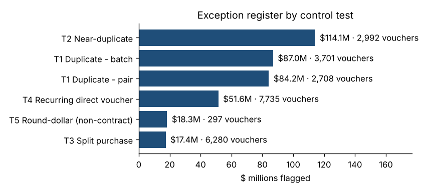
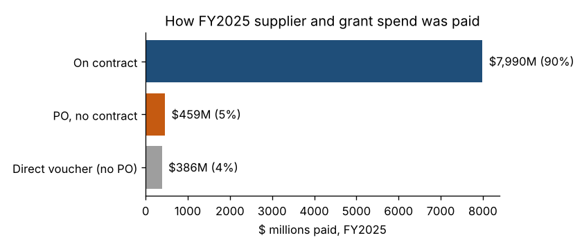
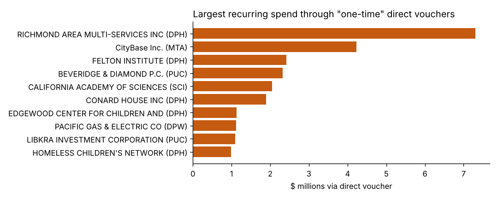
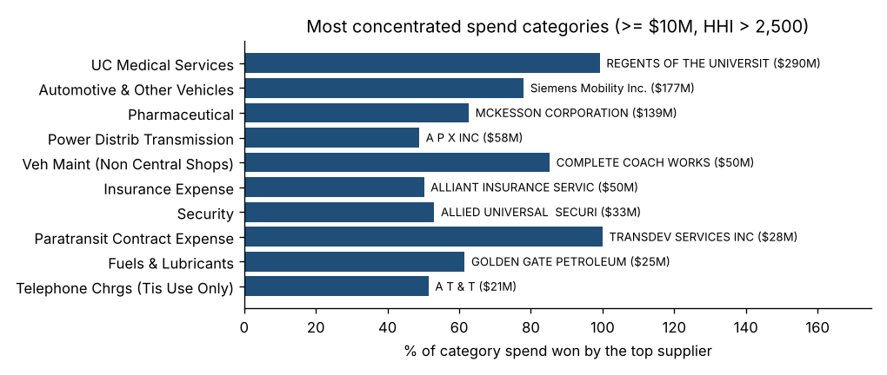
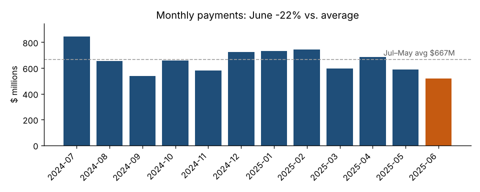
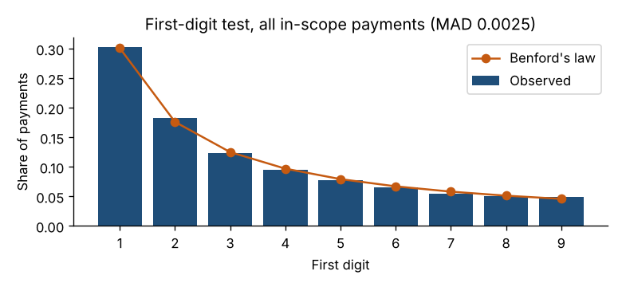
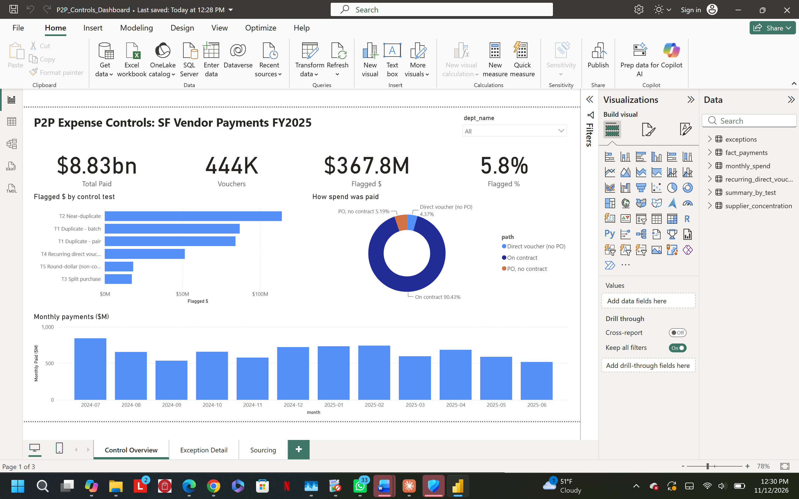
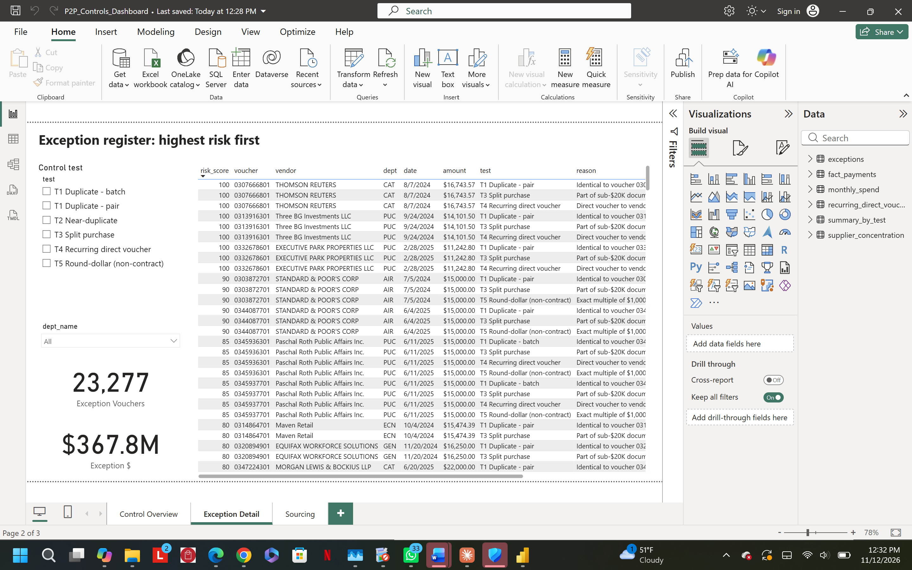
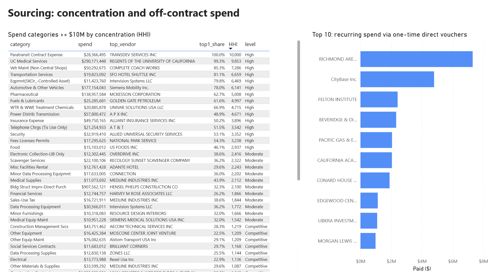

# P2P Expense Controls Analytics
### Duplicate-payment, split-purchase, and off-contract spend detection on 515,689 San Francisco vendor-voucher lines (FY2025)

**Leon Kitetu Ngumba** · Python (pandas, matplotlib) · Power BI · GenAI-assisted reporting with programmatic validation

---

## The question
If I ran disbursement controls for a large organization, **which payments would I want a human to look at first?**

Large payables teams can't review every payment. They need rules that surface the few vouchers most likely to be duplicated, split to dodge approval limits, or paid outside contracts, and then a ranked list to work from. This project builds that list from a real public ledger.

## Results at a glance
| | |
|---|---|
| Voucher lines analyzed | **515,689** ($16.76B total payments) |
| In-scope supplier and grant spend (after reconciliation) | **443,596 vouchers · $8.83B** |
| Vouchers flagged for review | **23,277 (5.8%) · $367.8M** |
| Potential duplicate pairs (highest priority) | **2,708 · $84.2M**, including 62 pairs of $100K+ ($64.0M) |
| Recurring spend through "one-time" direct vouchers | **145 vendor relationships · $51.6M** |
| Possible split purchases under the $20K delegated limit | **460 clusters · $17.4M** |
| Spend paid without a contract | **$845M (9.6%)** |
| Highly concentrated spend categories (HHI > 2,500) | **15 categories · $956M** |



## Data
- **Source:** City and County of San Francisco, Controller's Office, *Vendor Payments (Vouchers)*, DataSF dataset `n9pm-xkyq` ([data.gov listing](https://catalog.data.gov/dataset/vendor-payments-vouchers)). Public domain (ODC PDDL).
- **Slice:** fiscal year 2025 (July 1, 2024 – June 30, 2025), downloaded November 2026.
- **Grain:** one row per voucher accounting line, covering vendor, department, purchase order, contract, fund, account, amount paid, and posting date.
- **Not included in the public data:** invoice numbers, invoice dates, or approvers. Every result below is therefore a **lead for review, not a finding of error or fraud.**

### Get the data
The raw file (~250 MB) isn't stored in this repo. To reproduce:
1. Paste this link into a browser. It downloads only FY2025:
   `https://data.sf.gov/resource/n9pm-xkyq.csv?$where=fiscal_year='2025'&$limit=3000000`
2. Rename the file `sf_vouchers_fy2025.csv` and place it in a `data/` folder (or next to the notebook).
3. Run `p2p_controls_analysis.ipynb` top to bottom. It also runs in Google Colab.

## Method

### 1. Reconcile before testing
The dataset mixes supplier payments with treasury activity: debt service, tax refunds, liability accounts, and benefit payments. I reconciled $16.76B in total payments down to **$8.83B of goods, services, and grant spend** and kept the excluded $7.92B visible by category, so nothing disappears silently.

### 2. Classify every payment by spending path
SF spends three ways: **on contract**, **PO without a contract**, and **direct voucher** (no PO). The City's own guidance limits direct vouchers to *one-time, non-recurring* payments.



### 3. Eight control tests
| # | Test | Rule | Why it matters |
|---|---|---|---|
| T1 | **Duplicate payments** | Same vendor, department, PO, fund, account, and amount (≥ $1K) on different vouchers within 7 days. **Pairs** = Tier A; **3+ together** = Tier B (likely batched installments) | Money paid twice |
| T2 | **Near-duplicates** | Same vendor and PO, amounts within 1% (≥ $5K), within 7 days | Re-keyed invoices |
| T3 | **Split purchases** | 2–5 non-contract documents of $10K–$20K to one vendor within 14 days, totaling over $20K | SF's $20K delegated-purchasing limit (effective 7/1/2024) prohibits splitting |
| T4 | **Recurring direct vouchers** | Same vendor and department paid by direct voucher in 6+ months, $50K+ | Recurring spend bypassing POs and contracts |
| T5 | **Round-dollar amounts** | Exact $1,000 multiples ≥ $10K, outside contracts | Estimates instead of invoices |
| T6 | **Benford's law** | First-digit mean absolute deviation by department (Nigrini thresholds) | Fabricated or threshold-driven amounts |
| T7 | **Period-end spending** | June vs. July–May monthly average, citywide and by department | "Use it or lose it" behavior |
| T8 | **Category concentration** | Top-supplier share and HHI by spend category | Dependency risk and sourcing leverage |

### 4. Rank the exceptions
Each flagged voucher gets points per test it trips (Tier A duplicate 40, split 30, near-duplicate 25, recurring direct voucher 20, Tier B duplicate 15, round-dollar 10), plus 10–20 points for size. The weights are judgment calls, documented in the notebook so they can be challenged. **422 vouchers trip two or more tests.**

## Key findings
**1. Duplicate pairs: $84.2M.** The largest are two identical **$21,646,221** payments to the Regents of the University of California (Public Health), posted the same day on **two separate dates** (April 2 and May 21, 2025). That's consistent with catch-up installments on a fixed-fee agreement, but at that size the invoice schedule should be confirmed. 62 pairs exceed $100K.

**2. "One-time" direct vouchers used for recurring spend: $51.6M across 145 relationships.** That's half of all in-scope direct-voucher spend. Several vendors were paid this way every month of the year.



**3. 460 possible split-purchase clusters ($17.4M),** led by Public Health (133), MTA (85), and the City Administrator (80).

**4. Concentrated categories.** 15 categories worth $956M are highly concentrated. For example, Siemens Mobility holds 78% of the $177M Automotive & Other Vehicles category, and McKesson 63% of the $139M Pharmaceutical category.



**5. What the data did *not* show:**
- **No citywide year-end spending rush.** June payments ran 22% *below* average, which fits the cash-basis data, since June invoices are paid in July. Recreation & Park (+89% in June) is the exception worth a look.
- **Benford's law** conforms closely overall (MAD 0.0025). The nonconforming departments, led by Elections, are most likely explained by fixed-rate payments.

 

## Power BI dashboard
The output tables feed a three-page Power BI report (`dashboard/P2P_Controls_Dashboard.pbix`) built for a disbursement reviewer:

**1. Control Overview:** headline KPIs, flagged dollars by control test, spend by payment path, and monthly payments, filterable by department.


**2. Exception Detail:** the ranked exception register. Reviewers click a control test or department and work down from the highest risk score.


**3. Sourcing:** category concentration (top-supplier share and HHI) and the vendors paid repeatedly through one-time direct vouchers.


## GenAI with validation
The [exception memo](exception_memo.md) was **drafted with a generative AI assistant** from the output tables. I then wrote [`scripts/validate_memo.py`](scripts/validate_memo.py) to **recompute all 34 figures in the memo from the source data**. All 34 match, and the validation log is appended to the memo. The point is to use AI for speed while keeping every number traceable.

## Limitations and judgment calls
- **No invoice numbers** in the public data, so duplicates are matched on vendor, PO, account, amount, and date. Tiering separates likely installments from classic pairs.
- **Public agencies, banks, and benefit carriers** are excluded from T4 and T8 using a documented name rule, because the dataset's government flag is unreliable (e.g., the State Department of Health Care Services is marked "NO").
- **"Single Payment Payees"** is a catch-all payee name, so it's excluded from vendor-matching tests.
- **Posting date** (`data_as_of`) is used as the transaction date. 21,163 FY2025 vouchers ($973M) are dated outside July–June, which reflects payments made later against FY2025 budget lines.

## Repository
```
p2p_controls_analysis.ipynb     full analysis, with notes in every step
exception_memo.md               reviewer-facing memo + validation log
scripts/build_notebook.py       generates the notebook (single source of truth)
scripts/validate_memo.py        recomputes every memo figure from /output
output/                         tables for Power BI (fact_payments.zip, exceptions.csv, ...)
charts/                         figures used above
dashboard/                      Power BI report (.pbix) and page screenshots
```

## Tools
Python 3 (pandas, NumPy, matplotlib), Jupyter, Power BI, Claude (memo drafting).
